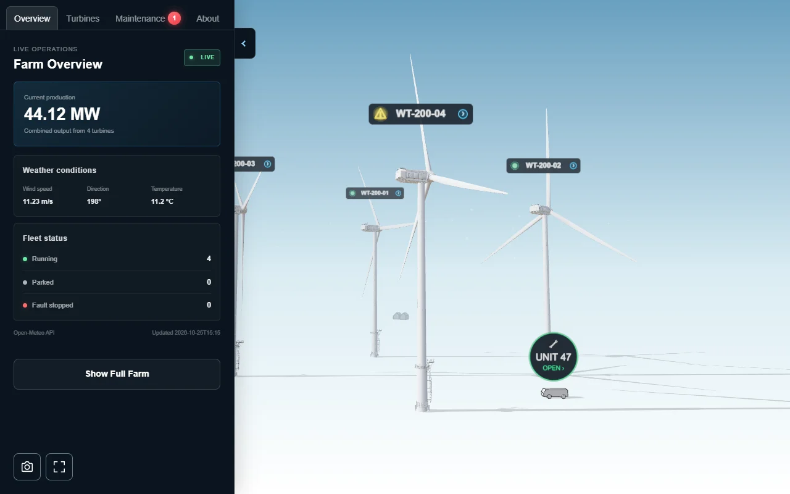

# Nour Altinawi

### Real-Time 3D / Frontend Developer

I build browser-based 3D applications with **Three.js / WebGL**, connecting interactive scenes to interfaces, application state, and data.

I bring **20+ years of professional 3D visualization experience**. My more recent work focuses on frontend and .NET full-stack development. Based in Sweden; founder of Nourtin.

[Selected projects](#selected-projects) · [Public code](#public-code) · [LinkedIn](https://www.linkedin.com/in/nour-tinawi) · [Contact](mailto:contact@nourtin.com)

## Selected projects

### Nordic RT · Architectural exploration

**Challenge:** Bring material comparison, model inspection, and architectural context into one browser interface.

**My contribution:** Developed the 3D viewer and its frontend interactions: coordinated camera views, material controls, Clay inspection with model dimensions, section navigation, and contextual detail panels. Refined desktop and touch layouts so the tools remain usable alongside the model.

**Stack:** Three.js / WebGL, JavaScript, Vite, HTML, CSS.

[Live application](https://nordic-rt.nourtin.com/) · [Case study and screenshots](https://github.com/Norman-Deen/nordic-rt-architectural-case-study)

### WindTwin · Industrial visualization prototype

**Challenge:** Connect asset selection in a 3D environment to monitoring and maintenance workflows.

**My contribution:** Developed the wind-farm environment, responsive monitoring interface, and simulated fault-to-work-order-to-service workflow. Integrated live weather context and connected asset selection to charts and condition panels.

**Stack:** Three.js / WebGL, TypeScript, Vite, Chart.js, Open-Meteo, HTML, CSS.

[Live application](https://windtwin.nourtin.com/) · [Case study and screenshots](https://github.com/Norman-Deen/windtwin-case-study)

*Prototype: weather is live; operational telemetry and maintenance are simulated. No physical turbine or production SCADA connection.*

**Source availability:** These two repositories contain public case studies, not application source. The live applications demonstrate the interactions; the case studies describe scope and contribution.

### More browser 3D work

| Project | Development focus | Links |
| --- | --- | --- |
| **PureDrive RT** | Automotive configuration, material interaction, lighting controls, and camera transitions. | [Live](https://puredrive-rt.nourtin.com/) / [Case study](https://github.com/Norman-Deen/puredrive-rt-case-study) |
| **PureNordStudio** | Furniture material selection, Clay/dimension inspection, image capture, and AI-assisted visualization. | [Live](https://purenordstudio.nourtin.com/) / [Case study](https://github.com/Norman-Deen/purenordstudio-case-study) |
| **ModernStillness** | Cinematic WebGL environment and interactive presentation. | [Live](https://modernstillness.nourtin.com/) / [Overview](case-studies/modernstillness.md) |

## Public code

Source repositories you can inspect directly:

- **AI Motion CAPTCHA** — graduation research prototype combining a JavaScript frontend, .NET 8 API, behavioral analysis, and ML.NET. [Backend source](https://github.com/Norman-Deen/CaptchaSysBackSmart) / [Frontend source](https://github.com/Norman-Deen/CaptchaSysFrontSmart).
- **[SiliconDesign](https://github.com/Norman-Deen/SiliconDesign)** — ASP.NET Core MVC, Identity, Entity Framework Core, and Web API coursework.
- **[Crito React](https://github.com/Norman-Deen/crito-React-Js)** — React frontend coursework.
- **[Rika](https://github.com/Norman-Deen/Rika)** — collaborative .NET and Azure Functions training project.

These earlier educational projects document my web-development foundation. My current focus is browser-based 3D and frontend application development.

## Technical background

- **Browser 3D:** Three.js, WebGL, materials, lighting, camera interaction, and model inspection.
- **Frontend:** TypeScript, JavaScript, SvelteKit, React, HTML, CSS, Vite.
- **Application integration:** C#, .NET, Node.js, REST APIs, SQL, Supabase.

My six-month industry placement at **Meta Bytes** involved SvelteKit, TypeScript, Go, Supabase, and REST APIs. I completed my **.NET full-stack qualification at EC Utbildning (2023–2025)**.

Open to **Real-Time 3D, Three.js / WebGL, and Frontend Developer** roles.

[Visual portfolio: Nourtin](https://nourtin.com/) · [LinkedIn](https://www.linkedin.com/in/nour-tinawi) · [Email](mailto:contact@nourtin.com)
