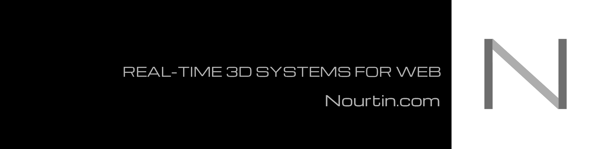

# Nour Altinawi

**Real-Time 3D Systems Engineer & Full-Stack Developer**  
Three.js · WebGL · TypeScript · Interactive 3D · Digital Twin Visualization

I combine more than 20 years of professional 3D visualization experience with modern web development. I build browser-based 3D applications, product configurators, industrial visualization prototypes, and interfaces connected to APIs and application state.

Based in Sweden. Founder of [Nourtin](https://nourtin.com/).

## Selected real-time 3D work

| Project | Engineering focus | Explore |
| --- | --- | --- |
| **WindTwin** | Operational wind-farm prototype: live weather, simulated telemetry, alerts, work orders, maintenance dispatch, and adaptive rendering | [Live demo](https://windtwin.nourtin.com/) · [Engineering overview](case-studies/windtwin.md) · [Full case study](https://nourtin.com/pages/Subpages/windtwin-case-study.html) |
| **Nordic RT** | Architectural visualization, phased loading, material interaction, and device-aware performance | [Live demo](https://nordic-rt.nourtin.com/) · [Case study repository](https://github.com/Norman-Deen/nordic-rt-architectural-case-study) |
| **PureDrive RT** | Automotive configuration, material systems, camera transitions, and rendering optimization | [Live demo](https://puredrive-rt.nourtin.com/) · [Case study repository](https://github.com/Norman-Deen/puredrive-rt-case-study) |
| **PureNordStudio** | Interactive furniture, material exploration, studio capture, and AI-assisted visualization workflows | [Live demo](https://purenordstudio.nourtin.com/) · [Case study repository](https://github.com/Norman-Deen/purenordstudio-case-study) |
| **ModernStillness** | Cinematic WebGL environment, baked lighting, particles, audio, and adaptive quality | [Live demo](https://modernstillness.nourtin.com/) · [Engineering overview](case-studies/modernstillness.md) |

WindTwin uses live weather context alongside simulated operational data; it is not connected to physical turbines or a production SCADA system. Case study repositories document the work and do not contain the complete application source or licensed assets.

## Full-stack development

My six-month industry placement at **Meta Bytes** involved SvelteKit, TypeScript, Go, Supabase, REST APIs, and cloud deployment workflows. I completed my .NET full-stack qualification at **EC Utbildning (2023–2025)**.

Public source examples:

- **[AI Motion CAPTCHA — API](https://github.com/Norman-Deen/CaptchaSysBackSmart)** and **[frontend](https://github.com/Norman-Deen/CaptchaSysFrontSmart)**: graduation research prototype combining JavaScript, .NET 8, behavioral analysis, and ML.NET.
- **[SiliconDesign](https://github.com/Norman-Deen/SiliconDesign)**: ASP.NET Core MVC, Identity, Entity Framework Core, and Web API coursework.
- **[Crito React](https://github.com/Norman-Deen/crito-React-Js)**: React frontend coursework.
- **[Rika](https://github.com/Norman-Deen/Rika)**: collaborative .NET and Azure Functions training project.

These educational repositories represent my development foundation; the real-time 3D projects above represent my current focus.

## Technical focus

- **Real-time graphics:** Three.js, WebGL, optimized assets, adaptive quality, responsive 3D interaction.
- **Frontend:** TypeScript, JavaScript, SvelteKit, React, HTML, CSS, Vite.
- **Backend and data:** C#, .NET, Node.js, REST APIs, SQL, Supabase.
- **Delivery and visual production:** Git, GitHub Actions, Docker, 3ds Max, rendering and asset pipelines.

## Contact

[Portfolio](https://nourtin.com/) · [LinkedIn](https://www.linkedin.com/in/nour-tinawi) · [Email](mailto:contact@nourtin.com)

Open to roles in **Three.js / WebGL, Real-Time 3D, Frontend Graphics, Industrial Visualization, and Full-Stack Development**.
